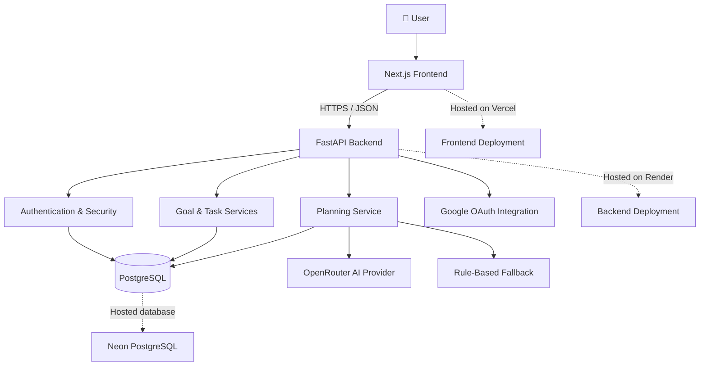

# ✨ AURA — Autonomous User Routine Assistant

<p align="center">
  
</p>

<p align="center">
  <strong>An AI-assisted goal planning and routine management platform.</strong>
  <br />
  Transform ambitions into structured plans, actionable tasks, and measurable progress.
</p>

<p align="center">
  <a href="https://aura-autonomous-user-routine-assist.vercel.app">
    
  </a>
  <a href="https://github.com/rudraksha-sh/AURA-Autonomous-User-Routine-Assistant-Agentic-Ai-System">
    
  </a>
  <a href="https://aura-backend-cz7k.onrender.com/docs">
    
  </a>
</p>

<p align="center">
  
  
  
  
  
  
  
  
</p>

---

## 🌌 Overview

**AURA (Autonomous User Routine Assistant)** is an AI-assisted productivity platform designed to bridge the gap between setting a goal and consistently executing the work required to achieve it.

Instead of leaving users with a simple checklist, AURA aims to transform goals into structured plans, organize tasks, and support progress tracking through an integrated web application.

The platform combines a modern web interface, a Python API, persistent data storage, AI-assisted planning, and a deterministic fallback planner.

### 🎯 The problem

People often struggle to translate ambitious goals into realistic daily actions. Generic task managers store tasks, but they do not necessarily help users determine what to do next.

### 💡 The AURA approach

- **Define:** Capture a goal and its relevant constraints.
- **Decompose:** Generate a structured, actionable plan.
- **Organize:** Represent planned work as persistent tasks.
- **Execute:** Manage tasks and update progress.
- **Improve:** Expand toward adaptive scheduling, personalized recommendations, and agentic workflows.

## 🚀 Live Application

| Component | Link |
|---|---|
| 🌐 Frontend application | [Launch AURA](https://aura-autonomous-user-routine-assist.vercel.app) |
| ⚙️ Backend API | [AURA Backend](https://aura-backend-cz7k.onrender.com) |
| 📚 API documentation | [Swagger UI](https://aura-backend-cz7k.onrender.com/docs) |
| 💻 Source code | [GitHub Repository](https://github.com/rudraksha-sh/AURA-Autonomous-User-Routine-Assistant-Agentic-Ai-System) |

*Deployment availability and API documentation depend on the current hosting configuration. The backend may take time to wake up after inactivity.*

## ✨ Features

### 🔐 Authentication and account security

- User registration and email verification.
- Password-based authentication.
- JWT-based API authentication.
- Email OTP workflows for supported account-security operations.
- Optional two-factor authentication workflows.

### 🎯 Goal management

- Create and manage goals.
- Store goal descriptions, priorities, and deadlines.
- Organize goal-related work into actionable tasks.
- Maintain persistent goal and task records.

### 🧠 AI-assisted planning

- Generate proposed plans from natural-language goals.
- Structure plans into individual tasks.
- Capture task descriptions, priorities, estimated duration, and ordering.
- Use OpenRouter when AI planning is configured.
- Fall back to deterministic rule-based planning when appropriate.
- Preview and save plans through supported API workflows.

### 📋 Task management

- Persist task status and priority.
- Track estimated duration and task ordering.
- Support optional task deadlines.
- Associate tasks with their goals.
- Use idempotency keys in supported plan-saving workflows to reduce duplicate writes during retries.

### 🔗 Google integration

- Google OAuth authorization flow.
- Persisted integration status.
- Support for configured Google account identity and Gmail, Calendar, and Drive scopes, subject to consent and implementation availability.

### 🛠️ Developer experience

- FastAPI-generated OpenAPI documentation.
- SQLAlchemy database models.
- Alembic database migrations.
- Pytest unit and integration test suites.
- Docker Compose configuration for local PostgreSQL.

> **Implementation note:** Feature availability can differ between local and deployed versions. Planned capabilities below are roadmap items, not claims that those capabilities are already implemented.

## 🏗️ System Architecture



### Request lifecycle

1. A user submits a goal through the frontend.
2. The frontend sends a request to the FastAPI backend.
3. The backend validates the request and applies the relevant business rules.
4. The planning service uses the configured AI provider or deterministic fallback.
5. The generated plan is returned for preview and can be saved through supported workflows.
6. Persisted goals and tasks can be retrieved for subsequent interactions.

## 🧰 Technology Stack

| Layer | Technologies |
|---|---|
| Frontend | Next.js, React, TypeScript |
| API | Python, FastAPI |
| Validation | Pydantic |
| ORM | SQLAlchemy |
| Migrations | Alembic |
| Database | PostgreSQL, SQLite for selected tests |
| AI integration | OpenRouter |
| Authentication | JWT, email verification, OTP workflows |
| External integration | Google OAuth |
| Frontend hosting | Vercel |
| Backend hosting | Render |
| Hosted database | Neon PostgreSQL |
| Testing | Pytest |
| Local database infrastructure | Docker Compose |

## 📂 Repository Structure

```text
AURA-Autonomous-User-Routine-Assistant-Agentic-Ai-System/
│
├── backend/
│   ├── app/
│   │   ├── agents/          # Agent and planner service logic
│   │   ├── api/routes/      # FastAPI route handlers
│   │   ├── core/            # Configuration and security
│   │   ├── integrations/    # External service integrations
│   │   ├── models/          # SQLAlchemy models
│   │   ├── schemas/         # Request and response schemas
│   │   └── services/        # Application business logic
│   │
│   ├── alembic/             # Database migrations
│   ├── scripts/             # Development utilities
│   ├── tests/               # API/integration tests
│   ├── unit_tests/          # Unit and isolated workflow tests
│   ├── docker-compose.yml   # Local PostgreSQL service
│   └── requirements.txt
│
├── frontend/
│   ├── app/                 # Next.js routes and pages
│   └── services/            # API service clients
│
├── .gitignore
└── README.md
```

*Directory contents may evolve as development continues.*

## ⚙️ Getting Started

### Prerequisites

Install the following tools:

- Git
- Python compatible with the backend dependencies
- Node.js and npm compatible with the frontend
- Docker Desktop with Docker Compose, or a separately configured PostgreSQL instance
- OpenRouter API key for live AI planning
- Google OAuth credentials for Google integration testing

### 1. Clone the repository

```bash
git clone https://github.com/rudraksha-sh/AURA-Autonomous-User-Routine-Assistant-Agentic-Ai-System.git

cd AURA-Autonomous-User-Routine-Assistant-Agentic-Ai-System
```

### 2. Start PostgreSQL

Open Docker Desktop and wait for the Docker Engine to become available.

From the backend directory, run:

```powershell
cd backend
docker compose up -d postgres
docker ps
```

The current Compose configuration maps host port `5433` to PostgreSQL's container port `5432`.

The Compose configuration defines `aura_db`. The integration test configuration expects a separate `aura_test_db`; verify that the dedicated test database exists before running the integration suite.

**Important:** Never point test cleanup fixtures at a production or personal development database.

### 3. Configure the backend

From `backend/`, create and activate a virtual environment:

```powershell
python -m venv .venv
.\.venv\Scripts\Activate.ps1

python -m pip install --upgrade pip
pip install -r requirements.txt
```

Create a local `.env` file using the repository's environment example, if available.

Configure the variables required by `backend/app/core/config.py`. These include:

| Variable | Purpose |
|---|---|
| `DATABASE_URL` | Database connection URL |
| `JWT_SECRET_KEY` | JWT signing secret |
| `OPENROUTER_API_KEY` | AI provider API key |
| `AI_PROVIDER` | Configured AI provider |
| `CORS_ORIGINS` | Permitted frontend origins |
| `GOOGLE_CLIENT_ID` | Google OAuth client ID |
| `GOOGLE_CLIENT_SECRET` | Google OAuth client secret |
| `GOOGLE_REDIRECT_URI` | Google OAuth callback URL |

Email and OTP settings may also be required. Refer to the backend configuration and environment example for exact names and defaults.

Never commit `.env` files, API keys, database passwords, or OAuth secrets.

Apply database migrations:

```powershell
alembic upgrade head
```

Start the backend:

```powershell
uvicorn app.main:app --reload
```

Typical local URLs:

- API: `http://127.0.0.1:8000`
- Swagger UI: `http://127.0.0.1:8000/docs`

Swagger UI is available only when enabled by the application configuration.

### 4. Configure the frontend

Open a second terminal at the repository root:

```powershell
cd frontend
npm install
```

Configure the frontend API base URL using the environment variable expected by the frontend code.

For a local backend, the API is typically:

```text
http://127.0.0.1:8000
```

Start the development server:

```powershell
npm run dev
```

Open:

[http://localhost:3000](http://localhost:3000)

## 🧪 Testing

Run tests from the `backend/` directory using the project's intended Python environment.

### Unit tests

```powershell
python -m pytest unit_tests/ -q
```

### Integration tests

```powershell
python -m pytest tests/ -x -q --tb=short
```

### Complete backend test run

```powershell
python -m pytest unit_tests/ tests/ -x -q --tb=short
```

**Known test status:** The integration suite has passed independently with 79 tests. The combined run currently has an outstanding `test_ai_plan_success` failure, where registration returns `409 Email is already registered`. The combined test database initialization/isolation issue still needs investigation.

Do not treat the combined suite as fully passing until it completes successfully.

## 🗺️ Roadmap

The following are potential future advancements. They should be marked complete only after implementation and verification.

### Phase 1 — Reliable core platform

- [ ] Resolve combined-suite database initialization and isolation.
- [ ] Establish repeatable local development and test setup.
- [ ] Verify authentication and account recovery end to end.
- [ ] Add CI checks for tests, formatting, and static analysis.
- [ ] Document API error handling and environment configuration.

### Phase 2 — Smarter goal planning

- [ ] Break large goals into hierarchical milestones and subtasks.
- [ ] Add dependency-aware task ordering.
- [ ] Improve deadline feasibility checks and workload balancing.
- [ ] Allow users to regenerate or edit individual tasks.
- [ ] Add explicit plan approval before committing proposed changes.
- [ ] Improve planner evaluation with repeatable benchmark scenarios.

### Phase 3 — Adaptive productivity

- [ ] Personalized planning based on user preferences.
- [ ] Rescheduling when tasks are missed or priorities change.
- [ ] Progress summaries and completion analytics.
- [ ] Daily and weekly planning reviews.
- [ ] Workload and capacity estimates.
- [ ] Explainable prioritization and recommendations.

### Phase 4 — Agentic workflows

- [ ] Tool-using planning agents with explicit permission boundaries.
- [ ] Multi-step workflows with observable execution state.
- [ ] Human approval for consequential actions.
- [ ] Retry policies, timeouts, and idempotent tool execution.
- [ ] Execution traces and audit logs.
- [ ] Safe recovery from failed or partially completed workflows.

### Phase 5 — Integrations and intelligence

- [ ] Calendar-aware planning and availability.
- [ ] Configurable reminders and notifications.
- [ ] Broader integration workflows for supported Google services.
- [ ] Retrieval of relevant user-provided context where appropriate.
- [ ] Evaluation of planner quality, latency, and cost.
- [ ] User feedback loops for improving future plans.

### Phase 6 — Production readiness

- [ ] Automated CI/CD validation.
- [ ] Structured logs, metrics, and error monitoring.
- [ ] Rate-limit and abuse-resistance testing.
- [ ] Database backup and recovery procedures.
- [ ] Security review and dependency scanning.
- [ ] Accessibility and responsive UI audits.
- [ ] Performance and reliability testing.

## 🔒 Security Principles

AURA should follow these principles as it evolves:

- Keep credentials in environment variables or an appropriate secret manager.
- Use strong, unique production secrets.
- Enforce authorization on protected resources.
- Validate and constrain AI-generated content before persistence or execution.
- Request only the external-service permissions required.
- Require confirmation before consequential agent actions.
- Keep sensitive tokens out of logs and source control.
- Use HTTPS for deployed traffic.
- Test rate limits, error handling, and authorization boundaries.

## 🤝 Contributing

Contributions and focused improvements are welcome.

1. Fork the repository or create a feature branch.
2. Pull the latest changes before beginning work.
3. Make a small, focused change.
4. Run the relevant tests.
5. Review your changes with `git diff` and `git status`.
6. Commit with a descriptive message.
7. Open a pull request describing the change and its verification.

Suggested branch naming:

```text
feature/goal-milestones
fix/test-database-isolation
docs/api-setup-guide
```

## 📌 Project Links

- **Live application:** https://aura-autonomous-user-routine-assist.vercel.app
- **Backend API:** https://aura-backend-cz7k.onrender.com
- **API documentation:** https://aura-backend-cz7k.onrender.com/docs
- **GitHub repository:** https://github.com/rudraksha-sh/AURA-Autonomous-User-Routine-Assistant-Agentic-Ai-System

## 📜 License

No license has been specified in the repository documentation. Add a `LICENSE` file before distributing the project under a particular open-source license.

---

<p align="center">
  <strong>Plan with purpose. Execute with clarity. Improve continuously.</strong>
  <br />
  Built as AURA evolves toward a more capable autonomous routine assistant.
</p>
