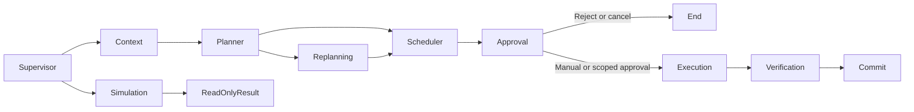

# AURA architecture

AURA retains Next.js, FastAPI, SQLAlchemy, PostgreSQL and Alembic. The new workflow workspace lives alongside the existing goal dashboard, task board, daily planner and settings.

```text
backend/app/agents/       Ten agent packages
backend/app/workflows/    Typed state, graph, node adapters, checkpoint journal, registry
backend/app/tools/        Local task creation and guarded recovery
backend/app/api/routes/   Versioned workflow and grant endpoints
backend/app/integrations/ Existing Google adapters and credential storage
backend/alembic/          Additive workflow and grant migration
backend/tests/agents/     Agent tests
backend/tests/workflows/  Workflow API and concurrency tests
frontend/app/(private)/planner/workflows/  Workspace
frontend/components/workflows/             Grant controls
```



The Supervisor routes typed intents. The graph makes zero LLM calls and reuses the deterministic planner. The existing AI path retains OpenRouter, with LangChain message types at the provider boundary. Goal descriptions are data. Their contents cannot route the graph or select tools.

Graph state carries tenant, run and thread IDs, intent, scope, plan, schedule, decision, evidence and trace. The graph has fixed paths and a 12-step recursion limit. PostgreSQL workflow mutations set statement and lock timeouts of 10 and 5 seconds. Manual approvals expire after 24 hours. Remote tracing is disabled during graph invocation.

At the approval boundary, the API commits a restricted checkpoint journal to PostgreSQL. Later requests restore it through LangGraph. Terminal runs clear the journal and retain results. Local writes, grant use, verification and the terminal result commit together. Starts use a client UUID and request fingerprint. Mutations use revisions. [LangGraph interrupt contract](https://docs.langchain.com/oss/python/langgraph/interrupts)

## HTTP contract

All paths require JWT authentication. FastAPI exposes machine-readable schemas at `/openapi.json`.

| Method and path | Contract |
| --- | --- |
| `POST /api/v1/workflows` | Start `plan_goal` or `simulate` using a fresh UUID. Use `previous_run_id` for a replan or `grant_id` for scoped local execution. |
| `GET /api/v1/workflows` | Up to 20 recent owned runs |
| `GET /api/v1/workflows/{id}` | Owned run status and result |
| `POST /api/v1/workflows/{id}/transition` | Approve, reject, pause, resume or cancel using the current revision |
| `GET /api/v1/workflows/{id}/audit` | Node outcomes and timestamps |
| `GET /api/v1/workflows/{id}/verification` | Recheck the task receipt |
| `POST /api/v1/workflows/{id}/undo` | Requires `confirm: true` and current revision |
| `GET, POST /api/v1/autonomy/grants` | List up to 50 owned grants or give scoped consent |
| `POST /api/v1/autonomy/grants/{id}/transition` | Pause, resume or revoke |
| `POST /api/v1/autonomy/stop` | Revoke current grants |
| `DELETE /api/planner/preferences` | Reset stored planning preferences |
| `PUT /api/v1/context/sources` | Index or reindex an owned goal, task or UTF-8 text/Markdown document with `authorized: true` |
| `GET, DELETE /api/v1/context/sources/{source_id}` | Read index status or revoke and purge the source |
| `POST /api/v1/context/search` | Semantic search over the owner's active corpus. Returns scores, chunk text and source/version references. |

A manual start accepts `{"intent":"plan_goal","run_id":"0142195d-2ccb-4b62-83e4-c25fb6852824","goal_id":42,"target_date":"2030-01-02","task_count":5}`. Simulation accepts a `scenario` matching the existing what-if schema. Refresh after a 409 revision conflict.

## Context retrieval

`backend/app/agents/context/` owns embedding, ingestion and retrieval. The context models and Alembic revision `53c42be41d70` store a tenant-owned source and overlapping 800-character chunks with 384-dimensional embeddings. A stable source identity and content digest make same-source retries idempotent. Document updates reuse the client `document_id`. Goal/task inputs use `kind` and `local_id`. Only title and description are indexed for local records. Edits to indexed goal/task fields invalidate and purge old chunks, and deletions cascade. Submit another authorized PUT to reindex; DELETE immediately revokes the index authorization.

Search filters by authenticated owner, active version and encoder revision in SQL before ranking with pgvector cosine distance. It uses exact search, up to 8 chunks, a 0.2 similarity floor, 100 sources per owner and 16,000 characters per source. Graph retrieval includes the selected goal, its indexed tasks and owned documents. The Planner receives one snapshot containing the goal fields and up to four provenance references. The rule planner adds a fixed reminder to review relevant sources. Retrieved text stays outside agent prompts, workflow state, plans and logs. Ingestion rejects recognized credential patterns, and context request validation suppresses caller input in logs. Integrations and OAuth records are outside ingestion scope. Owners must exclude credentials and unauthorized content from documents.

Execution checks the goal version and locks and revalidates referenced source versions in the write transaction. Updates, deletion, revocation and encoder revision changes cause a conflict for affected previews. Adding unrelated sources leaves existing previews valid. The workflow UI displays the provenance stored at preview time. An unavailable encoder yields a goal-only workflow and a 503 from search or ingestion.

### Setup and rollout

Install the approved `sentence-transformers` dependency in the backend environment and stage a trusted local CPU model directory that produces 384-dimensional embeddings. Set `CONTEXT_MODEL_PATH` and `CONTEXT_MODEL_REVISION` in the backend environment. Change the revision when weights, preprocessing or chunking change, then reindex with consent. Enable pgvector on the target PostgreSQL server and apply `alembic upgrade head` from `backend/` before starting the updated backend. Keep the encoder offline. SQLite cosine scoring is limited to isolated tests. Binary document parsing, automatic re-embedding and external connectors are outside this release.

## Readiness

| Area | State |
| --- | --- |
| Local graph, permissions and recovery | Implemented with transactional task creation, typed verification and conditional undo. |
| UI | Workflow history, plan and schedule estimates, simulation, replanning, grants, verification and undo use real API data. |
| Planning depth | Explicit milestone and task dependency graphs remain open. Approval creates tasks. Actual daily schedule approval continues through the existing daily planner. |
| Context and memory | Owned goals, working preferences and opt-in local retrieval are implemented. PostgreSQL vector execution still needs an extension-enabled verification run. External connectors and arbitrary durable facts remain open. |
| Intelligence | Deterministic workday feasibility and overdue count. Trained prediction requires evaluated data. |
| External effects | Transactional outbox, leased retries, dead letters and provider compensation are future work. |
| Operations | Distributed rate limiting, durable OAuth state, automated retention, full accessibility QA and production deployment remain open. |

## External action release boundary

External actions are one-resource, one-effect previews stored in `external_actions`. Confirmation binds a request UUID, user, goal, provider, operation, payload fingerprint, expiry and revision. Dispatch requires an allowlisted adapter. The default registry is empty, so external writes stay disabled. Run the bounded worker with `python -m app.agents.execution.worker`. Retries require evidence of no effect. Uncertain outcomes use lookup. Callback ingestion and compensation require provider-specific authentication and tests before production use. Database transactions provide atomic local state only.

Release gates: [Release readiness](RELEASE_READINESS.md).
