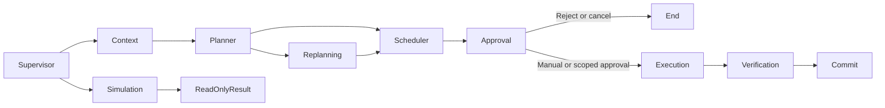

# AURA architecture

AURA retains Next.js, FastAPI, SQLAlchemy, PostgreSQL and Alembic. The new workflow workspace lives alongside the existing goal dashboard, task board, daily planner and settings.

```text
backend/app/agents/       Ten agent packages
backend/app/workflows/    Typed state, graph, node adapters, checkpoint journal, registry
backend/app/tools/        Local task creation and guarded recovery
backend/app/api/routes/   Versioned workflow and grant endpoints
backend/app/integrations/ Existing Google adapters and credential storage
backend/alembic/          Additive workflow and grant migration
backend/tests/agents/     Agent tests
backend/tests/workflows/  Workflow API and concurrency tests
frontend/app/(private)/planner/workflows/  Workspace
frontend/components/workflows/             Grant controls
```



The Supervisor routes typed intents. The graph makes zero LLM calls and reuses the deterministic planner. The existing AI path retains OpenRouter, with LangChain message types at the provider boundary. Goal descriptions are data. Their contents cannot route the graph or select tools.

Graph state carries tenant, run and thread IDs, intent, scope, plan, schedule, decision, evidence and trace. The graph has fixed paths and a 12-step recursion limit. PostgreSQL workflow mutations set statement and lock timeouts of 10 and 5 seconds. Manual approvals expire after 24 hours. Remote tracing is disabled during graph invocation.

At the approval boundary, the API commits a restricted checkpoint journal to PostgreSQL. Later requests restore it through LangGraph. Terminal runs clear the journal and retain results. Local writes, grant use, verification and the terminal result commit together. Starts use a client UUID and request fingerprint. Mutations use revisions. [LangGraph interrupt contract](https://docs.langchain.com/oss/python/langgraph/interrupts)

## HTTP contract

All paths require JWT authentication. FastAPI exposes machine-readable schemas at `/openapi.json`.

| Method and path | Contract |
| --- | --- |
| `POST /api/v1/workflows` | Start `plan_goal` or `simulate` using a fresh UUID. Use `previous_run_id` for a replan or `grant_id` for scoped local execution. |
| `GET /api/v1/workflows` | Up to 20 recent owned runs |
| `GET /api/v1/workflows/{id}` | Owned run status and result |
| `POST /api/v1/workflows/{id}/transition` | Approve, reject, pause, resume or cancel using the current revision |
| `GET /api/v1/workflows/{id}/audit` | Node outcomes and timestamps |
| `GET /api/v1/workflows/{id}/verification` | Recheck the task receipt |
| `POST /api/v1/workflows/{id}/undo` | Requires `confirm: true` and current revision |
| `GET, POST /api/v1/autonomy/grants` | List up to 50 owned grants or give scoped consent |
| `POST /api/v1/autonomy/grants/{id}/transition` | Pause, resume or revoke |
| `POST /api/v1/autonomy/stop` | Revoke current grants |
| `DELETE /api/planner/preferences` | Reset stored planning preferences |

A manual start accepts `{"intent":"plan_goal","run_id":"0142195d-2ccb-4b62-83e4-c25fb6852824","goal_id":42,"target_date":"2030-01-02","task_count":5}`. Simulation accepts a `scenario` matching the existing what-if schema. Refresh after a 409 revision conflict.

## Readiness

| Area | State |
| --- | --- |
| Local graph, permissions and recovery | Implemented with transactional task creation, typed verification and conditional undo. |
| UI | Workflow history, plan and schedule estimates, simulation, replanning, grants, verification and undo use real API data. |
| Planning depth | Explicit milestone and task dependency graphs remain open. Approval creates tasks. Actual daily schedule approval continues through the existing daily planner. |
| Context and memory | Owned goals and working preferences are supported. Gmail, Drive, GitHub, document retrieval and arbitrary durable facts remain open. |
| Intelligence | Deterministic workday feasibility and overdue count. Trained prediction requires evaluated data. |
| External effects | Transactional outbox, leased retries, dead letters and provider compensation are future work. |
| Operations | Distributed rate limiting, durable OAuth state, automated retention, full accessibility QA and production deployment remain open. |
